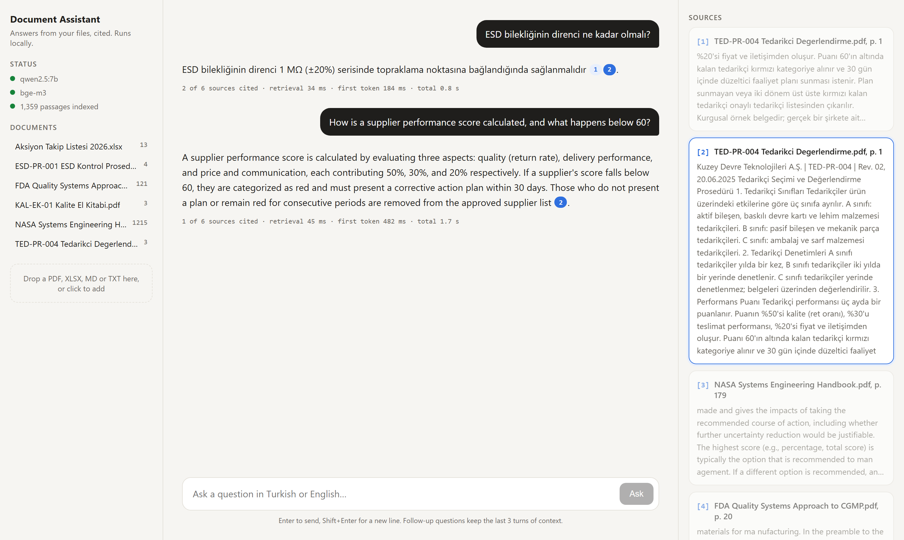
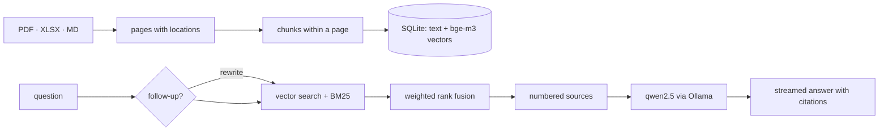

# Local RAG Assistant

Ask questions about your company's PDFs and spreadsheets, in Turkish or English, and get answers that cite the file and page they came from. Everything runs on your own machine through [Ollama](https://ollama.com). No document leaves it.



## Results

Measured on 28 labelled questions over 6 documents (1,359 passages), with `qwen2.5:7b` and `bge-m3` on an RTX 5060 Ti. The full report is in [eval/results.md](eval/results.md).

| | |
|---|---|
| Right page in the top 6 passages | **92%** with hybrid search (embeddings alone: 88%; keywords alone: 72%) |
| Answers with every expected fact and no wrong item | **82%** |
| Questions the documents don't cover, correctly declined | **3 of 3** |
| Median time to a complete answer | **0.8 s** (first token ≈ 0.3–0.5 s) |

**What fails, and why:**
- **Filtering a table.** For "which actions are still open for quality assurance?", the model gets the whole spreadsheet but lists rows from other teams too. It fails all 3 such questions. The real fix is to answer these with SQL over the sheet instead of asking a 7B model to filter text.
- **An English question about a Turkish spreadsheet.** "Purchasing department" never finds "Satın Alma" rows, and the model then answers from unrelated pages (`x-purchasing`).
- **Small sample.** With 25 answerable questions, one question is 4 points. The search settings below were chosen by reasoning, not by maximising this set, and differences of one or two questions are noise.

## Run it

You need Docker. The first start downloads about 5.5 GB of models.

```bash
git clone https://github.com/kaang457/local-rag-assistant && cd local-rag-assistant
docker compose up -d                                          # CPU
docker compose -f compose.yaml -f compose.gpu.yaml up -d      # NVIDIA GPU
```

Then open http://localhost:8000. To use your own files, put PDF, XLSX, MD or TXT files in `documents/` or drag them onto the page. Only new and changed files are re-indexed.

On a CPU, a 3B model answers several times faster: `CHAT_MODEL=qwen2.5:3b docker compose up -d`.

```bash
docker compose exec app python -m ragassist eval --answers    # rerun the evaluation
docker compose exec app python -m ragassist ask "AKS-008 kimde?"
```

## How it works



- **Every passage has one citation.** Chunks never cross a page, and each spreadsheet row is its own passage written as "Column: value" pairs. Small sheets are also indexed whole, as a markdown table, because "which actions are open?" needs every row at once.
- **Hybrid search, tuned for Turkish.** `bge-m3` embeddings handle meaning and cross-language questions. BM25 handles codes such as `AKS-008` or `IEC 61340-5-1`, and on exact-term questions it ranks the right page first 100% of the time against 60% for embeddings. Turkish suffixes ("prosedürü", "prosedüründe") are matched by truncating words to five letters, a standard approximation for Turkish retrieval. The two rankings are fused with reciprocal rank fusion. The keyword vote is halved and k = 10 instead of the usual 60, because an English question otherwise drags in every English page that shares its words.
- **Follow-up questions.** "And for suppliers?" is rewritten into a full question before searching. Both the original and the rewrite are searched, so a bad rewrite cannot hide what the question itself finds; a test fails if that fallback is removed.
- **Grounded answers.** The model sees numbered sources and must cite them, or say the documents don't cover the question. The page shows which sources were cited and fades the rest.
- **Incremental index.** Files are fingerprinted with SHA-256. Re-scanning only embeds what changed, and changing how chunks are built re-indexes everything automatically.
- **Small surface.** About 1,000 lines of Python with FastAPI, numpy and SQLite. There is no vector database to run: at a team folder's scale, a matrix product over all vectors takes milliseconds. The page is one HTML file with no external scripts.

## Repository

```
src/ragassist/   loaders, chunking, BM25, index, search, answer, API, evaluation, web page
eval/            28 labelled questions and the latest report
documents/       sample documents (below)
scripts/         generator for the fictional Turkish documents
tests/           25 tests with a fake model: chunking, index sync, search, citations, API
```

```bash
pip install -r requirements-dev.txt && pytest      # tests need no model
```

**Sample documents.** Three quality procedures and an action list for a *fictional* electronics manufacturer, in Turkish, generated by `scripts/make_samples.py`. Every page is marked as fictional. There are also two public-domain US government documents: the FDA's *Quality Systems Approach to Pharmaceutical CGMP Regulations* and the *NASA Systems Engineering Handbook*.

**Background.** This rewrites, from scratch, a document assistant I prototyped during an internship. The prototype was built on [digithree/ollama-rag](https://github.com/digithree/ollama-rag); none of its code is used here.

[MIT License](LICENSE)
